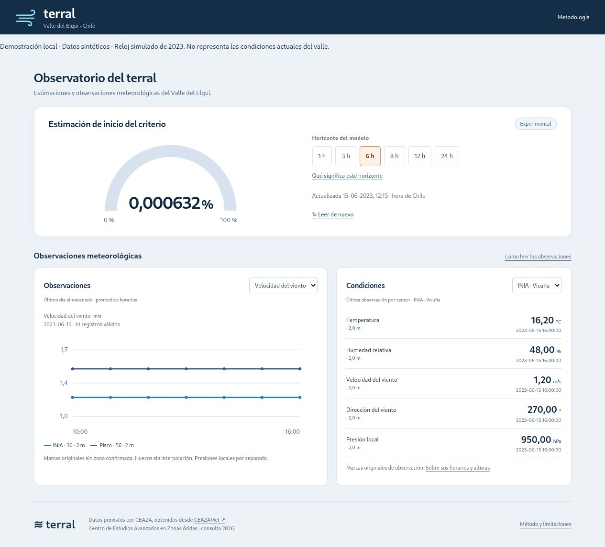

# Terral

**Un observatorio para explorar si podemos anticipar el terral del Valle del Elqui.**

[Ver el observatorio](https://www.terral.live/) · [Metodología](https://www.terral.live/metodologia) · [Arquitectura](docs/arquitectura.md)

El terral es un viento cálido y seco característico del Valle del Elqui, Chile. Este proyecto utiliza observaciones de INIA Vicuña y Pisco Elqui para estimar si las condiciones asociadas a su inicio podrían aparecer en las horas siguientes.

El trabajo reúne adquisición meteorológica, control de calidad, evaluación temporal de modelos y una aplicación web en funcionamiento. Los criterios para identificar el fenómeno toman como referencia a [Montes et al. (2016)](https://doi.org/10.1175/JAMC-D-15-0275.1).



*Captura de la demo local. Las observaciones y la fecha son sintéticas.*

## Qué incluye

- Seis modelos de **regresión logística con regularización L2**, para ventanas de **1, 3, 6, 8, 12 y 24 horas**. Utilizan 78 predictores construidos a partir de siete horas de observaciones de ambas estaciones.
- Adquisición HTTP secuencial, conservación de originales, hashes y normalización de XLS.
- Persistencia SQLite con revisiones de observaciones y registro de las entradas disponibles al emitir cada estimación.
- Panel adaptable a escritorio y móvil, servido con Python, HTML, CSS y JavaScript. Producción utiliza Gunicorn, Caddy y systemd.
- Código de investigación y protocolos para las comparaciones entre estaciones. [Mapa de la investigación](docs/investigacion.md).

## Probarlo en local

En Linux o macOS, con **Python 3.11 o posterior**:

```bash
git clone https://github.com/Dan-Araya/terral.git
cd terral
python3 -m aplicacion_terral.demo --port 8080
```

Abre **http://127.0.0.1:8080**. No requiere instalar dependencias ni disponer de credenciales.

La demo muestra el panel actual y ejecuta los modelos congelados sobre **datos inventados**, con un reloj simulado de 2023. Lo indica en la pantalla y en la API. No consulta CEAZAMet, no entrena modelos y elimina su base temporal al cerrar. Sus valores no son resultados de evaluación ni condiciones meteorológicas reales.

## Resultados históricos

Los modelos publicados se entrenaron con datos de **2013–2021** y se evaluaron con **2022–2023**: 104.100 estimaciones, 17.350 por ventana. Frente a una probabilidad fija ajustada a cada ventana, la reducción relativa del índice de Brier fue de aproximadamente **16 % a 20 %**.

Como ejemplo de evaluación de avisos, a seis horas y con un umbral seleccionado durante el entrenamiento usando una tolerancia de cuatro falsas alarmas mensuales, se anticiparon **16 de 21 episodios**, con **cinco horas de anticipación mediana entre los detectados** y **1,56 falsas alarmas por mes evaluable**. La tolerancia de selección y las falsas alarmas observadas son cantidades diferentes.

Estos resultados corresponden al criterio histórico y al soporte evaluado. La aplicación actual es experimental: la referencia temporal exacta de las marcas de CEAZAMet y su correspondencia con los intervalos físicos siguen pendientes de confirmación. [Resultados y límites](docs/metodologia.md).

## Pruebas

```bash
python3 -m unittest discover -s tests -v
python3 scripts/verificar_publicacion.py
```

Con Node.js 22 o posterior, también puedes comprobar la presentación, los decimales pequeños y las respuestas fuera de orden: `node tests/test_frontend.cjs`.

Las pruebas públicas utilizan datos sintéticos: verifican los seis modelos, los huecos y duplicados, la caducidad y la conservación de la última publicación durante un ciclo interrumpido. La integración continua ejecuta estas comprobaciones desde un clon limpio. Las auditorías históricas completas necesitan el archivo de investigación, que no se redistribuye aquí.

## Datos y ejecución real

El repositorio publica código, modelos congelados, protocolos y resultados agregados. **No incluye las observaciones originales, bases operativas, respaldos, credenciales ni los PDF de terceros.** La licencia MIT se aplica al código original del proyecto; no concede permisos sobre los datos de CEAZAMet ni sobre el artículo citado.

[Datos y reproducibilidad](docs/datos.md) · [Ejecución del servicio](docs/operacion.md) · [Contribuir](CONTRIBUTING.md)

Autor: [Dan Araya](https://github.com/Dan-Araya). Datos meteorológicos: [Centro de Estudios Avanzados en Zonas Áridas (CEAZA), red CEAZAMet](https://www.ceazamet.cl/).
