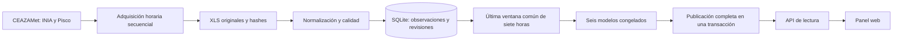

# Cómo funciona

La adquisición funciona de forma independiente de las visitas al panel. Una consulta del navegador lee el estado publicado; no descarga datos desde CEAZAMet ni entrena modelos.

El escritor conserva cada revisión de una observación, su recepción y la procedencia del archivo. Cada emisión identifica el modelo, la política y las versiones de las entradas utilizadas. El conjunto publicado se confirma al cerrar un ciclo completo. Mientras el ciclo siguiente trabaja, el lector conserva el conjunto anterior.

Una recepción reciente no demuestra que el sensor haya avanzado. La política HA-3 distingue la edad de recepción y el avance de las marcas nominales. Rechaza entradas fuera de su límite de caché de dos horas, antecedentes insuficientes o inválidos y condiciones de evento activo según el criterio histórico. Informa el tiempo sin avance; no lo transforma en una confirmación de frescura física.

## Dónde está el código

| Ruta | Responsabilidad |
| --- | --- |
| `aplicacion_terral/inferencia.py` | Calidad, ventana, 78 predictores y regresiones congeladas |
| `aplicacion_terral/modelos/` | Coeficientes, escalas, orden de variables y hash del modelo |
| `aplicacion_terral/g2/almacen.py` | Observaciones, revisiones, recepciones y cierres SQLite |
| `aplicacion_terral/g2/ciclo.py` | Adquisición secuencial y control de ejecución |
| `aplicacion_terral/ha3/operacion.py` | Selección al corte, emisiones y publicación coherente |
| `aplicacion_terral/g4/` | Transporte, adaptador operativo, WSGI y frontend actual |
| `aplicacion_terral/demo.py` | Demo local con entradas sintéticas y reloj simulado |

G1/G2/G3/G4 son nombres de etapas del desarrollo. Se mantienen en los módulos para conservar su trazabilidad; la ruta operativa actual es G4 con HA-3. Las políticas G1/G2 presentes son dependencias de las evaluaciones heredadas, no la decisión vigente de activación.

No hay un framework de frontend, un proceso de compilación JavaScript ni servicios externos necesarios para ejecutar la demo.
